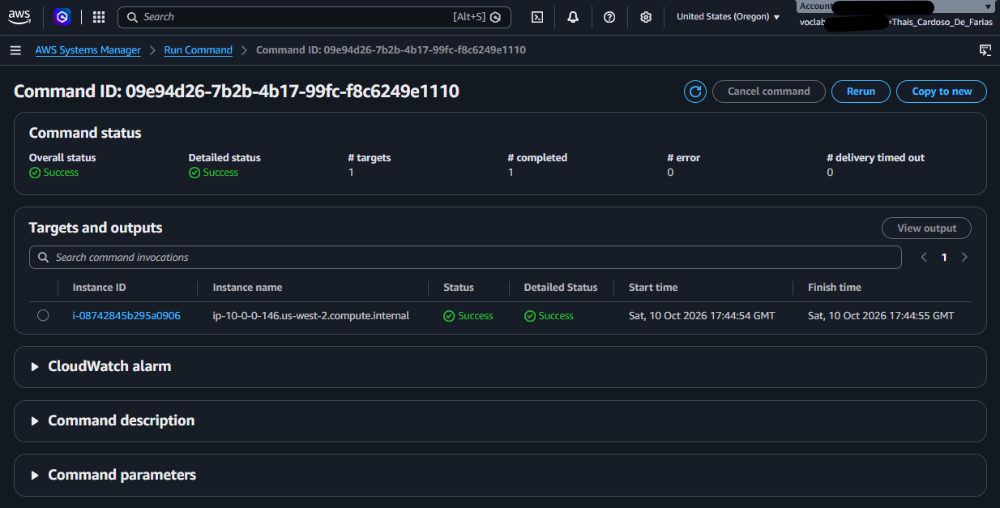
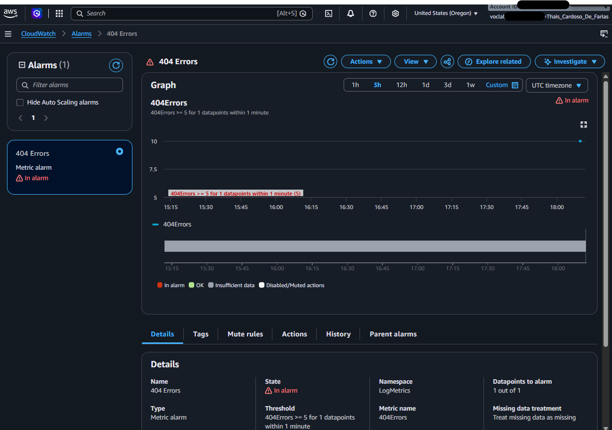
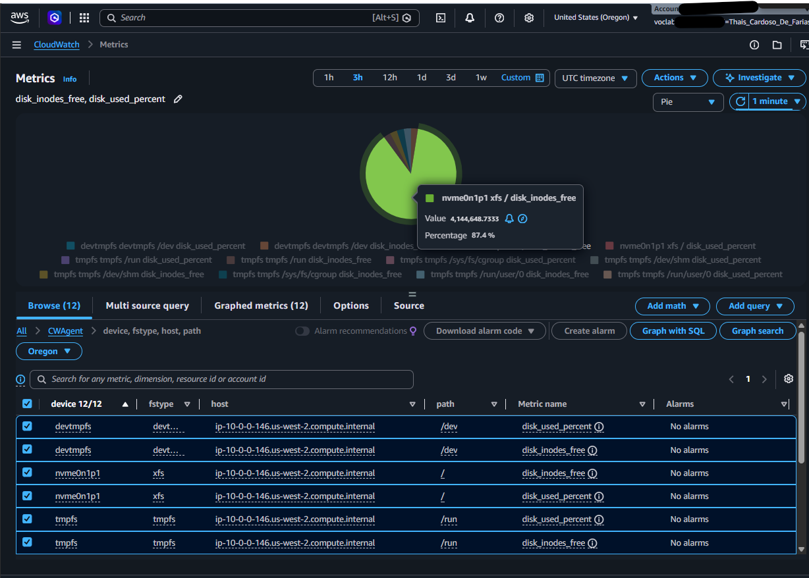
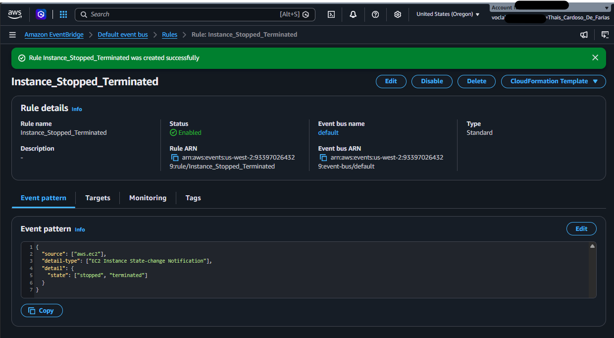
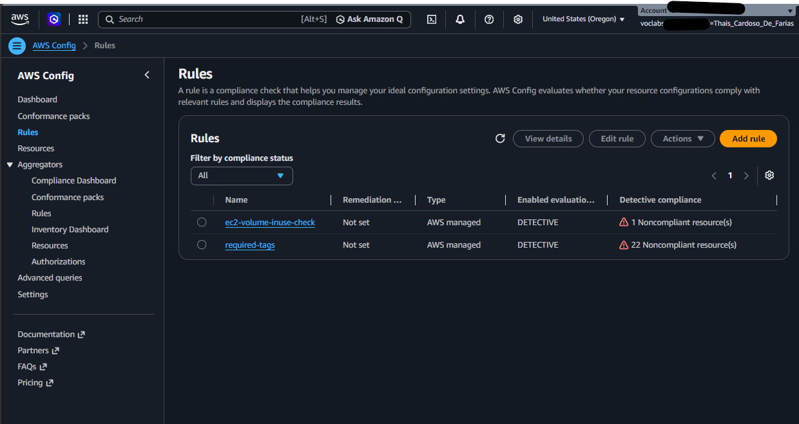

# 📊 Laboratório de Monitoramento e Conformidade de Infraestrutura na AWS

Este repositório documenta a realização de um laboratório prático focado em **Observabilidade, Monitoramento e Governança** na **AWS (Amazon Web Services)**. O objetivo foi configurar uma arquitetura completa de monitoramento proativo para instâncias EC2, utilizando serviços nativos da nuvem para coleta de logs, métricas do sistema operacional, alarmes automatizados, eventos em tempo real e auditoria de conformidade.

---

## 🛠️ Tecnologias e Serviços Utilizados

* **Amazon EC2:** Servidor web hospedado em ambiente Linux (`t3.micro`).
* **AWS Systems Manager (SSM):** Utilizado via *Run Command* e *Parameter Store* para gerenciamento remoto e configuração do agente.
* **Amazon CloudWatch:**
  * **Logs:** Coleta de logs de acesso e erro do Apache para análise de erros (404).
  * **Metrics / CWAgent:** Coleta de métricas avançadas internas (espaço em disco, memória RAM, CPU).
  * **Alarms:** Disparo de notificações automatizadas baseadas em limites de requisições e falhas.
* **Amazon EventBridge / CloudWatch Events:** Captura de notificações de alteração de estado da instância (Stop/Terminate).
* **Amazon SNS (Simple Notification Service):** Envio de alertas e notificações em tempo real por e-mail.
* **AWS Config:** Auditoria contínua de conformidade de recursos baseada em regras gerenciadas (políticas de tags e recursos órfãos).

---

## 🚀 Passo a Passo e Evidências

### Task 1: Instalação e Configuração do Agente CloudWatch via Systems Manager
Nesta etapa, o AWS Systems Manager foi utilizado para instalar o agente do CloudWatch na instância EC2 sem precisar acessá-la manualmente via SSH. As regras de configuração de logs e métricas foram centralizadas no Parameter Store.

* **Evidência da Instalação do Agente:**

---

### Task 2: Monitoramento de Logs e Criação de Alarmes (CloudWatch Logs)
Foram gerados erros propositais (acesso a páginas inexistentes /404) no servidor web. A partir disso, configurou-se um filtro de métricas no `HttpAccessLog` para disparar um alarme no CloudWatch sempre que ocorressem múltiplos erros em um intervalo específico, enviando uma notificação via SNS.

* **Evidência do Alarme Disparado (Estado ALARM):**

---

### Task 3: Monitoramento de Métricas Avançadas de Sistema (CWAgent)
Enquanto as métricas padrão do EC2 monitoram a máquina por "fora" (hypervisor), o agente do CloudWatch instalado internamente (`CWAgent`) permitiu capturar métricas vitais de dentro do sistema operacional, como o percentual de uso de memória RAM e partições de disco.

* **Evidência das Métricas do CWAgent:**

---

### Task 4: Notificações em Tempo Real (EventBridge / CloudWatch Events)
Foi criada uma regra de eventos para escutar alterações de estado no ciclo de vida do Amazon EC2. Sempre que a instância é interrompida (`stopped`) ou encerrada (`terminated`), o EventBridge aciona um tópico SNS para notificar a equipe em tempo real.

* **Evidência da Regra de Eventos Criada:**

---

### Task 5: Auditoria de Conformidade de Infraestrutura (AWS Config)
Para garantir governança corporativa, o AWS Config foi habilitado para avaliar continuamente os recursos da conta com base em padrões de segurança e melhores práticas. Foram aplicadas regras gerenciadas para validar se os recursos possuem tags obrigatórias (`project`) e identificar volumes EBS órfãos (não utilizados).

* **Evidência do Status de Conformidade no AWS Config:**

---

## 💡 Principais Aprendizados
* Capacidade de configurar e gerenciar agentes de monitoramento em ambientes em nuvem em larga escala usando **Systems Manager**.
* Criação de **observabilidade ponta a ponta**, conectando logs de aplicações web a filtros customizados, alarmes e canais de notificação (SNS).
* Implementação de **governança e compliance automatizado** na nuvem AWS utilizando o **AWS Config**.

---
Feito com 💻 por [Seu Nome]
